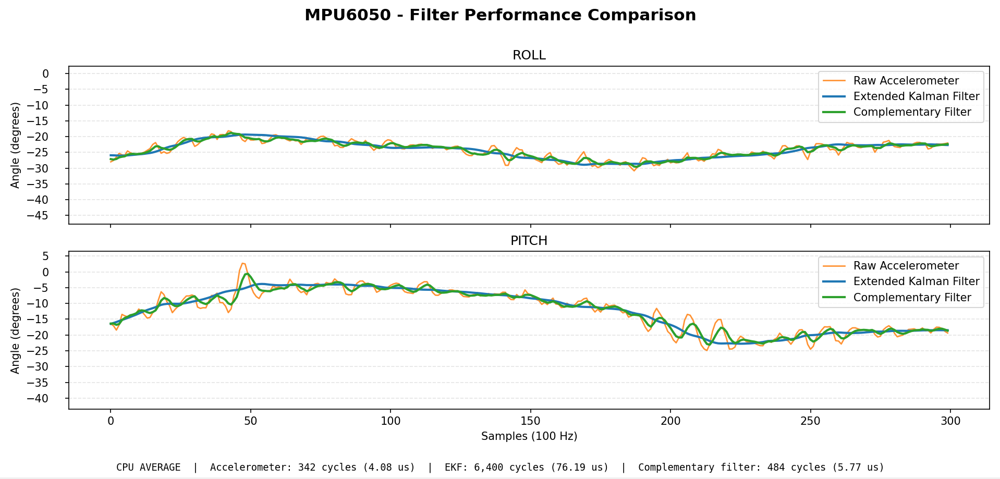
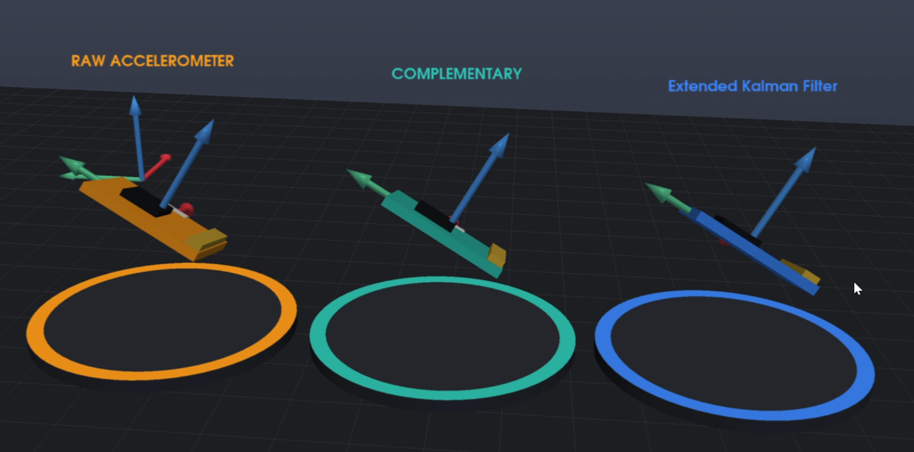

# MPU6050 Attitude Estimation on STM32F401RE

**Raw accelerometer vs complementary filter vs quaternion EKF: live comparison, 3D visualization and CPU-cycle benchmark.**

This project reads an MPU6050 (accelerometer + gyroscope) with an STM32 Nucleo-F401RE and estimates **roll and pitch** three different ways:

1. **Raw accelerometer angles** (no filtering)
2. **Complementary filter**
3. **Extended Kalman filter (EKF) on a quaternion**

The three estimates are plotted live with Python (matplotlib + pyserial), shown side by side on 3D boards (Python), and their CPU cost is measured on the MCU with the Cortex-M4 DWT cycle counter.






## Results

### Noise / stability (qualitative)

Observed on the live curves, with the board resting on the table and while tapping it:

| Estimator | Behavior |
|---|---|
| **EKF (quaternion)** | Smoothest: least jitter |
| **Complementary filter** | A little noisier than the EKF |
| **Raw accelerometer** | Noisiest: reacts to every vibration |

### CPU cost (STM32F401RE @ 84 MHz, measured with `DWT->CYCCNT`)

| Estimator | Cycles | Time | Share of the 10 ms loop |
|---|---:|---:|---:|
| Raw accelerometer angles | 342 | 4.08 µs | 0.037 % |
| Complementary filter | 484 | 5.77 µs | 0.052 % |
| EKF (quaternion) | 6400 | 76.19 µs | 0.76 % |

The EKF takes about **14.6x** more cycles than the complementary filter (6386 vs 438), and still uses **less than 1 %** of the CPU at 100 Hz.

### Why is the complementary filter so cheap?

- **One state, no matrices.** Per angle it does one gyro integration, one wrapped error and one blend (about ten float operations). `alpha` is a constant, so there is no division and no trigonometry inside the filter.
- **The EKF carries a 4-state quaternion and a 4x4 covariance matrix.** Every step multiplies several small matrices (`F·P·Fᵀ`, the Kalman gain, the covariance update), inverts a 3x3 matrix, normalizes the quaternion (`sqrtf`) and converts it to Euler angles (`atan2f` twice and `asinf`). That is roughly 450 to 500 multiply-adds plus a few expensive library calls.
- **Matrix cost grows quickly with the state size** (a 4x4 product is 64 multiply-adds, a 1-state filter needs one).

### Caveats

- The ranking depends on tuning. This build uses complementary `alpha = 0.68`, EKF `sigma_gyro = 0.01 rad/s` and `sigma_acc = 0.01 g`. A higher `alpha` (0.95 to 0.98) makes the complementary filter smoother but slower to react.
- The noise comparison is visual. For numbers, `tools/plot_filters.m` prints the standard deviation of each estimator while the board is still.
- Cycle counts depend on the compiler optimization level, the FPU settings and the Flash/cache behavior. They exclude the I2C read and the UART transmission. Measured on the Debug configuration with `-O2`.
- Yaw is not corrected (it needs a magnetometer), so only roll and pitch are meaningful.

## Hardware and software

| | |
|---|---|
| Board | ST Nucleo-F401RE |
| Sensor | MPU6050 breakout (GY-521) |
| IDE | STM32CubeIDE 1.19 (a newer version should open the project, possibly after a migration prompt) |
| Live plots (optional) | Python 3.9+ with `matplotlib`, `pyserial` |
| 3D viewer (optional) | Python 3.9+ with `pyvista`, `numpy`, `pyserial` |
| MATLAB script (optional) | Desktop MATLAB R2019b or later |

### Wiring

| MPU6050 | Nucleo-F401RE |
|---|---|
| VCC | 3V3 |
| GND | GND |
| SCL | PB8 (I2C1_SCL) |
| SDA | PB9 (I2C1_SDA) |
| AD0 | GND (I2C address 0x68) |

### Firmware configuration

- System clock 84 MHz (HSI + PLL)
- I2C1 at 400 kHz (fast mode)
- USART2 at 115200 8N1 through the ST-LINK virtual COM port (PA2/PA3)
- MPU6050: accelerometer ±2 g, gyroscope ±500 °/s, internal low-pass filter about 44 Hz
- Main loop at 100 Hz; `dt` is measured with the DWT counter
- 1 s gyro offset calibration at start-up: **keep the board still after reset**

## How it works

```
MPU6050 --I2C--> STM32F401RE --CSV over UART--> Python live plot / Python 3D viewer / MATLAB
```

**Raw accelerometer angles**

```
roll  = atan2(ay, az)
pitch = atan(-ax / sqrt(ay² + az²))
```

**Complementary filter** (one instance per angle, fixed `alpha`)

```
angle = alpha * (angle + gyro * dt) + (1 - alpha) * accAngle
```

The error is wrapped to the shortest way around the circle, so the roll can cross ±180°.

**EKF on a quaternion** `q = [w, x, y, z]`

- Prediction with the gyro: `q <- q + 0.5 * dt * q ⊗ [0, ωx, ωy, ωz]`, covariance `P <- F·P·Fᵀ + Q`
- Update with the accelerometer, which measures the direction of gravity in the body frame: `h(q) = [2(xz - wy), 2(yz + wx), w² - x² - y² + z²]`
- `h(q)` is not linear, so it is linearized with its Jacobian at each step. That is what makes it an *extended* Kalman filter.
- The accelerometer update is skipped when `| |a| - 1 g | > 0.3 g` (the board is accelerating).
- The quaternion is converted to roll and pitch only for display. There is no gimbal lock and no ±180° special case.

## Run it

### 1. Firmware

1. Open the project in STM32CubeIDE (`File > Open Projects from File System`, choose `firmware/`).
2. Build and flash. For the cycle numbers, use the Debug configuration with optimization `-O2` (`Properties > C/C++ Build > Settings > MCU GCC Compiler > Optimization`).
3. Keep the board still for about 1 second after reset.

The UART sends one line per sample at 115200 baud:

```
accRoll,accPitch,ekfRoll,ekfPitch,compRoll,compPitch,cycAcc,cycEkf,cycComp
```

### 2. Live curves and CPU cycles with Python (matplotlib)

```bash
pip install -U matplotlib pyserial
python tools/imu_viewer.py
```

Set `PORT` at the top of the script to your serial port (for example `COM5`). The window shows roll and pitch for the three estimators, and the average CPU cycles of each one at the bottom.

Close PuTTY or any other program that uses the same COM port first.

Cycles are measured around each block with the DWT counter:

```c
uint32_t c0 = DWT->CYCCNT;
/* ... block to measure ... */
dbg_cyc_ekf = DWT->CYCCNT - c0;   /* microseconds = cycles / 84 */
```

### 3. 3D comparison in Python

```bash
pip install -U pyvista numpy pyserial
python tools/viewer3d_pro.py COM5      # real data (use your serial port)
python tools/viewer3d_pro.py demo      # simulated motion, no board needed
```

Three boards are shown side by side: raw accelerometer, complementary filter and EKF. The red, green and blue arrows are the sensor X, Y and Z axes (the same convention as ROS/RViz). Mouse: left drag rotates, wheel zooms, middle drag pans. If the drawn board does not match your sensor, switch `BOARD_ALONG_Y` at the top of the script.

Close PuTTY or any other program that uses the same COM port first.

### 4. MATLAB (optional)

Run `tools/plot_filters.m` (set your COM port inside). It plots the three estimators live and prints the standard deviation of each one when you close the figure.

## Use the filters on another MCU

`ekf_quat.c` and `comp_filter.c` (with their headers) are plain C and only need `<math.h>`. Only `mpu6050.c` depends on the STM32 HAL I2C driver.

```c
/* EKF: gyro in rad/s, accelerometer in g, angles in degrees */
EKF_Quat_t ekf;
EKF_Init(&ekf, 0.01f, 0.01f);              /* sigma_gyro, sigma_acc */
EKF_SetFromAccel(&ekf, ax, ay, az);        /* initial attitude */
/* every sample: */
EKF_Predict(&ekf, gx, gy, gz, dt);
EKF_UpdateAccel(&ekf, ax, ay, az);
EKF_GetEuler(&ekf, &roll, &pitch, &yaw);

/* Complementary filter: gyro rate in deg/s, angle in degrees */
Comp_t c;
Comp_Init(&c, 0.98f);                      /* alpha */
angle = Comp_Update(&c, accAngleDeg, gyroRateDps, dt);
```

## Repository structure

```
.
├── firmware/            STM32CubeIDE project (Nucleo-F401RE)
│   ├── Core/Inc, Core/Src   main.c, mpu6050, ekf_quat, comp_filter
│   ├── Drivers/             STM32 HAL and CMSIS (ST licenses apply)
│   └── <project>.ioc        CubeMX configuration
├── tools/
│   ├── imu_viewer.py        live matplotlib curves + CPU cycles
│   ├── viewer3d_pro.py      3D comparison (has a demo mode)
│   └── plot_filters.m       MATLAB live plot + noise statistics
├── docs/                screenshots
├── LICENSE
└── README.md
```

## Limitations and next steps

- The EKF has no gyro-bias states, so its accuracy depends on the start-up calibration. A 7-state EKF (quaternion + bias) is the natural next step.
- No yaw correction. Adding a magnetometer (MPU9250 or ICM-20948) would fix the yaw drift.
- Compare with Madgwick and Mahony filters.
- Quantify the noise with the standard deviation on a longer recording, and test several `alpha` and sigma values.

## Credits

- Inspired by the Phil's Lab videos on attitude estimation with Kalman filters.
- STM32 HAL, CMSIS and the startup code come from STMicroelectronics (see the license files in `firmware/Drivers/`).

## Author and license

Rayen Zahzeh. My own code is released under the MIT License (see `LICENSE`). Files under `firmware/Drivers/` keep their original ST licenses.